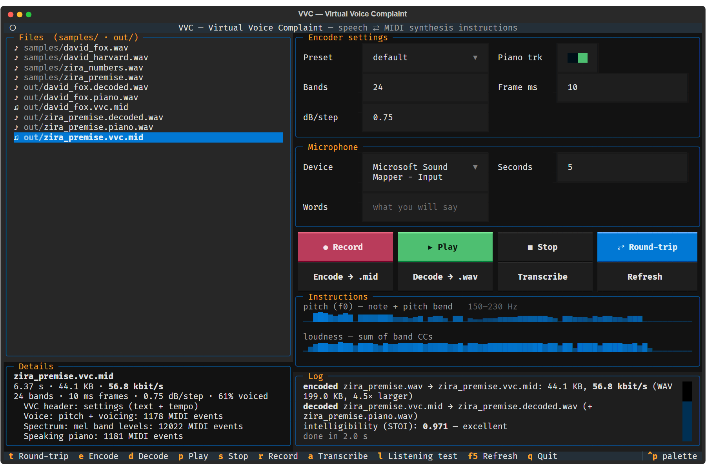
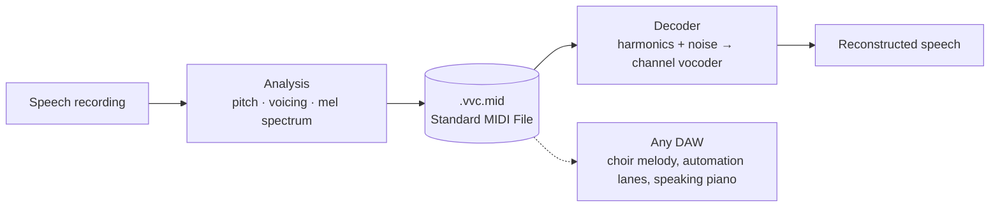

# VVC · Virtual Voice Complaint

**Speech stored as MIDI, and turned back into words.**


VVC is an experiment that asks a simple question: **can human speech be written down as musical or
synthesis instructions, and then reliably rebuilt into the same message?**

Instead of storing a waveform, the VVC encoder listens to a recording and writes down what a
synthesizer would need to say it again. The pitch of the voice becomes notes and pitch bend. How
breathy it sounds becomes a controller. The shape of the spectrum, which is what makes an "a" sound
different from an "s", becomes 24 controller lanes that change every 10 milliseconds. All of it goes
into an ordinary MIDI file. The decoder plays those instructions through a vocoder, and the message
comes back.

Because the file is plain MIDI, any DAW can open it. The speech melody plays on a choir patch, the
spectrum shows up as automation lanes, and an optional extra track plays the speech as a
"speaking piano".



## Results at a glance

| | |
|---|---|
| Default setting | 24 bands, 10 ms frames: **24.5 kbit/s** gzipped, about 10× smaller than 16 kHz WAV |
| Intelligibility | STOI **0.95**. Whisper's transcript of the decoded speech matches its transcript of the original **word for word** |
| Smallest file that keeps the words | about **3.7 kbit/s** (24 bands, 40 ms frames, 10 dB steps: 3 % drift on average, 9 % on the hardest clip) |
| Cost of using MIDI | **none measurable**. Rounding to 7-bit controllers scores the same as unrounded values |
| Where the words live | in the spectral envelope. Pitch, melody and voicing can be thrown away and Whisper still hears the same sentence |

Tested on four English TTS sentences and one real Danish recording. Full tables are in
[docs/RESULTS.md](docs/RESULTS.md).

## How it works



The encoder cuts the recording into short frames and measures three things in each:

- **Pitch and voicing.** A pitch tracker (YIN) finds the fundamental frequency whenever the voice is
  buzzing. A note starts when voicing starts, and pitch bend follows the exact contour with about 0.3
  cent precision.
- **Breathiness.** How noisy the voice is, from a pure tone to pure noise, stored as one controller.
- **Spectral envelope.** The energy in 24 mel-spaced frequency bands between 80 Hz and 7.6 kHz, one
  controller lane per band, at 0.75 dB per step.

The decoder builds a buzz of harmonics at the stored pitch, mixes in noise for breath and consonants,
and shapes the result band by band until it matches the stored spectrum. That is a classic channel
vocoder, so the voice sounds robotic while the words come through.

The file layout, the controller numbers and the exact formulas are in
[docs/FORMAT.md](docs/FORMAT.md).

## Getting started

You need Python 3.10 or newer. The codec itself only needs NumPy and SciPy and runs anywhere. The
terminal app's audio playback, the built-in text-to-speech samples and the fallback speech
recognizer use Windows.

```bash
git clone <repository-url> vvc
cd vvc
pip install -e ".[all]"
```

`[all]` adds the terminal app (Textual, sounddevice) and the experiment tools (pystoi, OpenAI
Whisper). Use `pip install -e .` for the codec alone. Whisper downloads its *medium* model (about
1.5 GB) the first time it transcribes something. Set `VVC_WHISPER_MODEL=small` for a smaller, less
accurate one.

Create a few test sentences, or put your own `.wav` files in `samples/`:

```powershell
powershell -ExecutionPolicy Bypass -File tools\make_samples.ps1
```

Encode and decode from the command line:

```bash
vvc encode samples/david_fox.wav out/david_fox.vvc.mid
vvc decode out/david_fox.vvc.mid out/david_fox.decoded.wav --piano out/david_fox.piano.wav
```

| Encoder option | Default | Effect |
|---|---|---|
| `--bands N` | 24 | Number of spectral bands (12 per MIDI channel) |
| `--hop-ms N` | 10 | Frame length in milliseconds |
| `--db-step X` | 0.75 | Decibels per controller step |
| `--no-piano` | off | Leave out the speaking-piano track |

`python -m vvc …` works the same as `vvc …` if you skip the install.

## The terminal app

```bash
vvc
```

The app puts the whole experiment in one window. Pick a file on the left to see its size, bitrate and,
for a `.mid`, its settings and the pitch and loudness it stores. Choose a preset or set bands, frame
length and precision yourself. Record your own voice, round-trip it through MIDI and hear the result
straight away, with its intelligibility score.

| Key | Action |
|---|---|
| `t` | Round trip: encode the selected WAV, decode it, show its STOI score and play it |
| `e` / `d` | Encode a WAV to `.mid` / decode a `.mid` to WAV |
| `p` / `s` | Play / stop |
| `r` | Record from the microphone into `samples/` |
| `a` | Transcribe with Whisper and compare with the words you typed when recording |
| `l` | Open the blind listening test |
| `F5` / `q` | Refresh / quit |

## The experiments

Three scripts turn the question into numbers. Each writes a report to `out/`, and
[docs/RESULTS.md](docs/RESULTS.md) explains the method and every result.

**Does speech survive?** `python tools/evaluate.py` encodes every sample with five presets, from 35 to
4 kbit/s, and scores the decoded audio with STOI and with Whisper.

**Where does it break?** `python tools/stress.py` pushes one setting at a time towards the extreme:
fewer bands, longer frames, coarser levels. It also tests what happens when the pitch is snapped to
semitones, flattened to a monotone or removed entirely.

**Do people and machines break in the same place?** `python tools/make_listening_test.py` builds a
blind test of 24 Danish sentences in 12 degradation conditions, and `vvc listen` runs it. Your answers
are compared with Whisper's on exactly the same audio, including how sure each of you was. The answer
key, the clean recordings and the MIDI behind every clip are kept read-only with checksums, so a run
can always be checked and repeated.

## What the experiments show

1. **Speech survives the trip through MIDI.** At the default setting Whisper hears exactly the same
   words in the decoded audio as in the original, in English and in Danish.
2. **MIDI's resolution is not the limit.** 7-bit controllers and 14-bit pitch bend lose nothing
   measurable. All the loss comes from the vocoder model, so better quality has to come from a better
   decoder.
3. **The message lives in the spectral envelope.** Pitch and voicing carry who is speaking and how.
   Remove them and the words remain. Acoustic similarity, intelligibility and the speaker's identity
   are separate qualities, and VVC can keep the second while discarding most of the other two.
4. **Frequency detail matters most.** Levels can be rounded to 16 dB steps with no loss, frames can
   stretch to 40 ms, but fewer than 8 bands breaks the language quickly.
5. **Whisper fails confidently.** When the audio gets too poor it writes fluent, plausible and wrong
   sentences instead of admitting it can't hear them. The listening test is built to find out whether
   people do the same.

## Limitations

- Only one real recording (Danish, one speaker, five seconds) has been tested. The other clips are
  clean synthetic speech. Noise, reverb and more voices are untested.
- Intelligibility is judged by STOI and Whisper. Human listening results are not in yet, and voice
  identity and naturalness have not been measured.
- The reconstruction has not been tried inside a DAW, only in the VVC decoder. DAWs that re-save MIDI
  may drop the text event the decoder needs.
- VVC is a study of representation, not a competitive codec. Opus manages better quality at 6 to 12
  kbit/s, and LPC-10 needs only 2.4 kbit/s.

## Project layout

```
vvc/
  codec.py         analysis, MIDI mapping and vocoder synthesis
  smf.py           minimal MIDI file reader and writer, no dependencies
  dsp.py           STFT, mel filterbank, YIN pitch tracker, WAV input and output
  asr.py           speech recognition: Whisper, with the Windows recognizer as fallback
  eval_text.py     word error rate, strict and lenient
  tui.py           terminal app
  listening.py     blind listening test
  __main__.py      command line
tools/
  evaluate.py              presets experiment
  stress.py                breaking-point experiment
  make_listening_test.py   builds a sealed listening test
  make_samples.ps1         English test sentences (Windows TTS)
  tts_winrt.ps1            Danish and other OneCore voices (Windows TTS)
  asr.ps1                  offline Windows recognizer (English only)
docs/
  FORMAT.md        the VVC file format
  RESULTS.md       method and results of every experiment
samples/           your speech goes here (ignored by git)
out/               everything VVC generates (ignored by git)
```

## Ideas for what comes next

- Run the listening test with several listeners, ideally with matrix sentences (as in the Danish
  Dantale II test) so knowing the word list gives nothing away.
- Measure voice identity with a speaker-embedding model, to complete the three-way comparison.
- Store breathiness per band instead of once per frame, for clearer *s*, *f* and breathy voices.
- Decode the same instructions with a neural vocoder for a far more natural voice.
- Rebuild the speech entirely inside a DAW by driving a vocoder plugin's bands from the CC lanes.

## Acknowledgements

VVC builds on the YIN pitch estimator (de Cheveigné and Kawahara, 2002) and the STOI intelligibility
measure (Taal et al., 2011, via [pystoi](https://github.com/mpariente/pystoi)). Speech recognition uses
[OpenAI Whisper](https://github.com/openai/whisper), and the terminal app is built with
[Textual](https://github.com/Textualize/textual).
